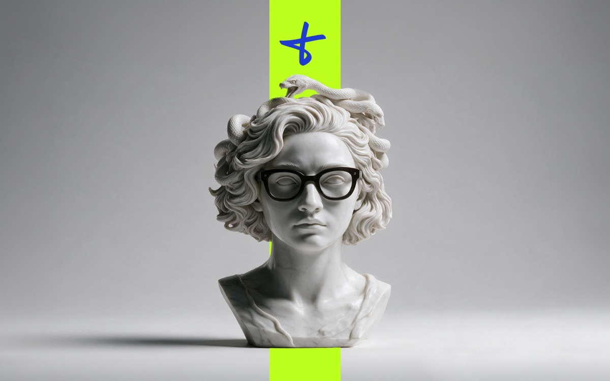
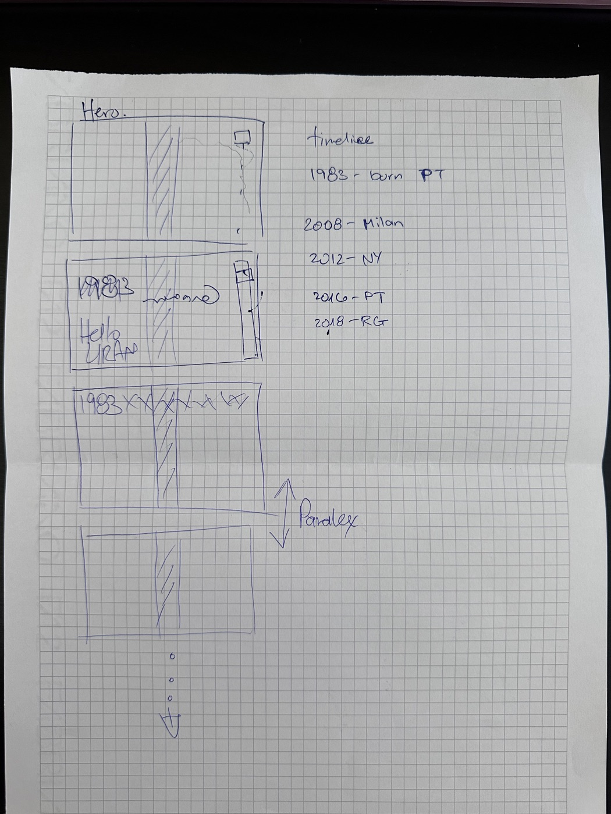
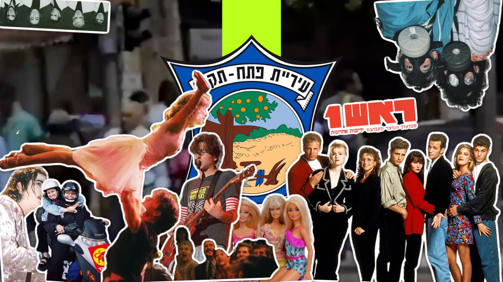
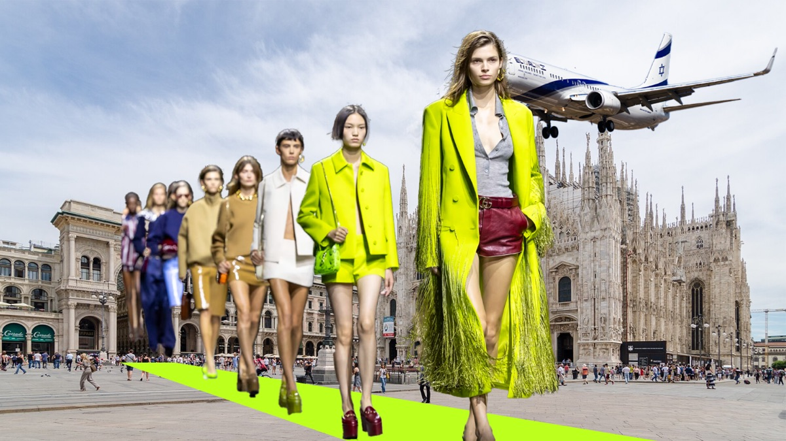
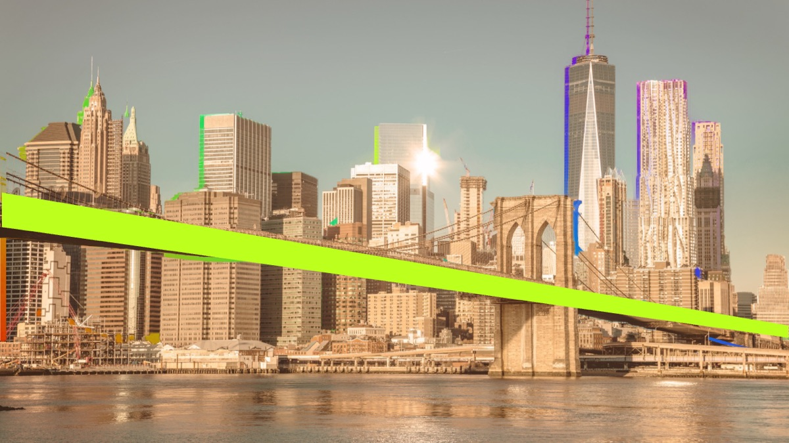
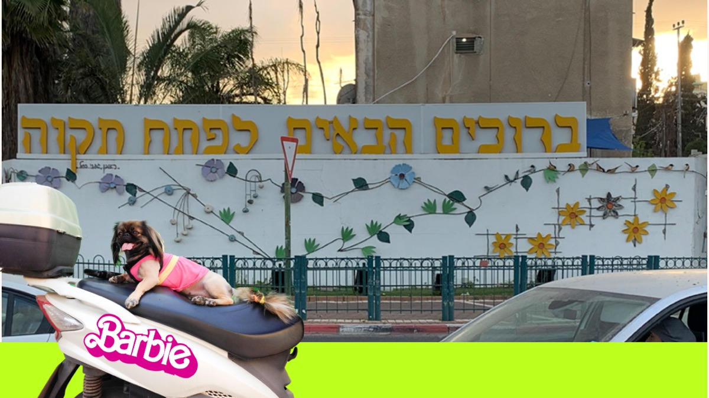
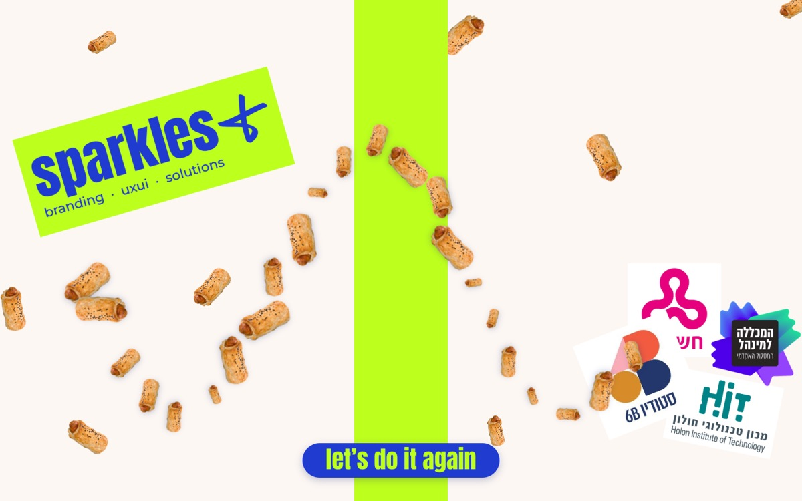

<div dir="rtl">

# Liran Amar//life timeline

ציר זמן אישי: מפתח תקווה, דרך מילאנו וניו יורק, חזרה הביתה ועד sparkles. כל תחנה היא פריים במסך מלא, והמעבר ביניהם נעשה בגלילה.

**לאתר החי:** https://liranamar.github.io/portfolio/

</div>



<div dir="rtl">

## תהליך העבודה

### 1. סקיצה על נייר
הכול התחיל בסקיצה על דף משבצות ומחשבה איך להעביר את הפרקים המרכזיים בחיי

</div>

<p align="center"></p>

<div dir="rtl">

מה כבר נקבע בסקיצה, ונשאר עד הגרסה הסופית:

- **Hero:** פריים פתיחה עם פס אנכי באמצע המסך (המלבן המקווקו), דמות בצד ולוגו קטן למעלה.
- **Hello LIRAN:** פריים היכרות עם הטקסט "Hello", "my name" ו-"LIRAN".
- **ציר זמן:** בראש כל פריים שורת השנים (`1983 XX XX…`), והשנה הפעילה מודגשת.
- **התחנות:** 1983 נולדתי בפתח תקווה, 2008 מילאנו, 2012 ניו יורק, 2016 חזרה לפתח תקווה. בסקיצה התחנה האחרונה היא 2018. בעיצוב היא הפכה ל-2017 ו-sparkles.
- **Paralax:** פריימים שנערמים זה על זה בגלילה. בקוד זה מומש כפריימים "דביקים", כשהפריים הבא מחליק מעל הקודם.
- **גלילה למטה:** חץ עם נקודות שמוביל לאורך כל הסיפור.

הפס האנכי בסקיצה הפך לחוט המקשר של כל האתר: פס בצבע ליים (`#BDFF1D`) שעובר בכל פריים. בחלק מהקולאז'ים הוא משנה צורה: מסלול תצוגה במילאנו, כביש של גשר ברוקלין בניו יורק, כביש בפתח תקווה.

### 2. עיצוב ב-Figma

כל פריים עוצב ב-Figma כ-artboard בגודל 1920×1080:

- **צבעים:** ליים `#BDFF1D`, כחול `#1F3BD0`, כחול כהה `#0E1C6C`, שמנת `#FCF7F3`.
- **פונטים:** Anton לכותרות ולשנים, Libre Caslon Display ל-"my name is", ו-Neonderthaw ל-"Hello".
- **פריימי ציר זמן:** בכל אחד מהם שורת השנים, שמות המקומות והתבליטים של אותה תקופה.
- **פריימי קולאז':** אחרי כל שנה מגיע קולאז' של המקום. כל קולאז' מורכב משכבות נפרדות, כדי שאפשר יהיה להנפיש כל שכבה בנפרד. למשל, תמונת מנהטן מפורקת לנהר, לבניינים, לשמיים ולגשר.

### 3. מ-Figma לקוד

האתר נבנה ישירות מקובץ ה-Figma: המידות, המיקומים והתמונות נלקחו מהעיצוב. העבודה נעשתה עם Claude Code, שמחובר ל-Figma דרך ה-Figma MCP. הוא קורא את הפריימים, מוריד את השכבות ובונה מהן את הקוד.

השלבים לפי היסטוריית ה-git:

| תאריך | שלב |
|---|---|
| 9.11 | גרסה ראשונה של האתר מתוך עיצוב ה-Figma |
| 10.11 | פרויקטים ותמונות חדשים, סרטון פתח תקווה, עדכון הקולאז'ים של ניו יורק ו-sparkles |
| 14.11 | סבב עבודה גדול: מסך מלא, אנימציות חדשות לכל קולאז', ועדכון לגרסה האחרונה של Figma |

### 4. סבב העבודה האחרון: פריים אחרי פריים

כל פריים עבר כמה סבבים של ניסיון, הערה ותיקון. הנה מה שנעשה בכל אחד, כולל מה שלא עבד:

**כל הפריימים**
- כל פריים ממלא את כל החלון. התוכן של ה-artboard ממורכז בתוכו. בפריימים עם טקסט רואים תמיד את כל התוכן. בפריימים שמבוססים על תמונה, התמונה מכסה את כל המסך, כמו `cover`.
- הגלילה מתקדמת פריים אחד בכל פעם. כל פריים מחכה לגלילה משלו: גלילה שנעשית בזמן מעבר לא נשמרת "בתור" ולא מקפיצה פריים אוטומטית.

**Hero**
- **ניסיון ראשון:** נחשי שיש שזוחלים מהשיער של הפסל, מצוירים על canvas. אחרי בדיקה התוצאה לא התאימה, והוחלט לחזור לפסל סטטי לגמרי.
- **התיקון:** הלוגו עלה על הפסל במסכים שהיחס שלהם אינו 16:9. עכשיו הלוגו גדל ביחד עם הפסל ועם תמונת הרקע.

</div>



<div dir="rtl">

**פתח תקווה (1983)**
- הסרטון רץ ברקע עם הפס הירוק. אחרי 3 שניות עולה הלוגו של העיר, ואחרי 2 שניות נוספות שאר התמונות מודבקות אחת אחרי השנייה, כמו **סטיקרים של שנות ה-90**: קו מתאר לבן, צל, הדבקה עם "מעיכה" והטיה קלה.
- **בעיה:** בגרסה הראשונה הקו הלבן נוצר בדפדפן משרשרת של צללים (`drop-shadow`), והאנימציה הייתה מקוטעת.
- **פתרון:** הקו הלבן והצל "נאפים" מראש לתוך קבצי התמונות בעזרת סקריפט Python ([tools/bake_stickers.py](tools/bake_stickers.py)), ועכשיו האנימציה חלקה. הסקריפט גם מסנן פיקסלים בודדים, כדי שלא יקבלו מסגרת לבנה משלהם.

</div>



<div dir="rtl">

**מילאנו (2008)**
- בפתיחה רואים רק את הדואומו והפס הירוק. הפס עובר **אפקט גליץ'**: קפיצות בין צורות שבורות, עם עותקים בטורקיז ובמג'נטה. בסוף הוא נוחת כ**מסלול תצוגה**.
- שבע הדוגמניות צועדות מנקודת המגוז של המסלול לעבר המצלמה, ובמקביל המטוס של אל על חוצה את השמיים מימין לשמאל, וחוזר כל 12 שניות.

</div>



<div dir="rtl">

**ניו יורק (2012)**
- הפריים נפתח עם גיף צבעוני, ותמונת מנהטן נבנית מעליו בסדר קבוע:
  1. הנהר מחליק מלמטה.
  2. הבניינים נופלים מלמעלה כמעט ביחד.
  3. רק אחרי שכולם במקום, השמיים מצטרפים.
  4. הגשר "נחתם" למקומו.
  5. הפס הירוק נורה מימין לאורך הגשר "כמו כדור".
- הסדר והקצב השתנו כמה פעמים לפי הערות, עד שהגענו לרצף הזה.

</div>



<div dir="rtl">

**back home (2016)**
- הפריים מופיע ישר עם תמונת השלט "ברוכים הבאים לפתח תקווה".
- הפס הירוק הפך לכביש, שמחליק משמאל. הקטנוע עם לוגו ה-Barbie "נוסע" על הכביש למקומו, והכלבה ברבי מתנשפת עם הלשון.

</div>



<div dir="rtl">

**sparkles (2017)**
- הלוגואים מודבקים כמו מדבקות, ואחריהם נוחתות הנקניקיות ("משה").
- אחרי שכולם נחתו, **סמן העכבר הופך לנקניקייה**. כל תנועה של העכבר מוסיפה נקניקיות לאורך הדרך, בכיוון ובגודל אקראיים.
- בסוף נפתח כפתור **"let's do it again"**, שמחזיר לתחילת האתר.
- **באג שנתפס:** הקוד שעוקב אחרי מצב הפריים הפעיל את עצמו בלולאה אינסופית, והדף קפא כבר בטעינה. התיקון: מאפסים רק כשבאמת יש מה לאפס.

### 5. איך בדקתי

- **צילומי מסך:** אחרי כל שינוי צילמתי את הפריים בדפדפן (Chrome headless) והשוויתי לצילום מ-Figma. בדקתי ביחסי מסך שונים: 16:9, ‏16:10, ‏5:4, ו-21:9 לצג רחב.
- **תנועה:** את התנועה עצמה, כלומר תזמון, חלקות ותחושה, בדקתי בעין בדפדפן אמיתי. ההערות מכל בדיקה הפכו לסבב התיקונים הבא.

## מבנה הקוד

האתר הוא HTML, CSS ו-JavaScript נקיים, בלי ספריות ובלי שלב build.

| קובץ | תפקיד |
|---|---|
| `index.html` | פריים הפתיחה ופריים ה-Hello. שאר הסיפור נוצר מתוך `script.js` |
| `script.js` | **התוכן**: מערך `chapters`, עם שנה, מקום, תבליטים והקולאז' של כל תחנה. לכל חלק בקולאז' יש מיקום בפיקסלים של Figma, אפקט כניסה (`fx`) ועיכוב (`delay`). כאן גם הגלילה פריים-אחר-פריים ומצב הנקניקיות |
| `styles.css` | העיצוב וכל האנימציות. מתחילים מאפקט ה-`fx` הרלוונטי |
| `assets/` | התמונות והסרטון שהאתר משתמש בהם |
| `tools/bake_stickers.py` | הסקריפט שמוסיף לתמונות את הקו הלבן של הסטיקר |
| `docs/` | הסקיצה וצילומי המסך של ה-README |

**איך המיקומים עובדים:** כל המיקומים כתובים בפיקסלים של Figma, ביחידה `--u`, שהיא פיקסל אחד של Figma אחרי שינוי גודל לחלון. `--fit` מבטיחה שכל ה-artboard ייראה, ו-`--fill` שהוא יכסה את כל המסך. `--ox` ו-`--oy` ממרכזים את ה-artboard בחלון.

כדי לשנות מיקום או תזמון של תמונה, משנים את המספרים שלה ב-`chapters` שב-`script.js`.

## הרצה מקומית ופרסום

- **הרצה מקומית:** אפשר פשוט לפתוח את `index.html` בדפדפן. אם רוצים שרת מקומי:

</div>

```bash
python3 -m http.server
```

<div dir="rtl">

- **פרסום:** האתר מתפרסם אוטומטית ב-GitHub Pages מכל push ל-`main`.
- **מטמון:** אחרי שינוי ב-`styles.css` או ב-`script.js`, כדאי להעלות את מספר הגרסה בקישור ב-`index.html` (`?v=…`). כך הדפדפנים טוענים את הקובץ החדש ולא גרסה ישנה מהמטמון.
- **תמונת סטיקר חדשה:** מאפים לה את הקו הלבן עם הסקריפט (צריך Pillow):

</div>

```bash
python3 tools/bake_stickers.py assets/img pt-aviv pt-dance 'pt-rosh1!'
```

<div dir="rtl">

הסקריפט יוצר `<name>-sticker.png` לצד המקור. שם שמסתיים ב-`!` שומר על פרטים דקים, כמו טקסט קטן.

## כלים

- **Figma:** עיצוב.
- **Claude Code + Figma MCP:** תרגום העיצוב לקוד ועבודה בסבבים.
- **Python + Pillow:** הכנת תמונות הסטיקרים.
- **Chrome (headless):** בדיקות ויזואליות.
- **GitHub Pages:** אחסון.

</div>
